# Plotline Studios

Plotline Studios is a collection of tools for giving your pen plotter some really fun stuff to do.

<!-- sample:plotter -->

<a href="docs/readme/examples/plotter/short.mp4">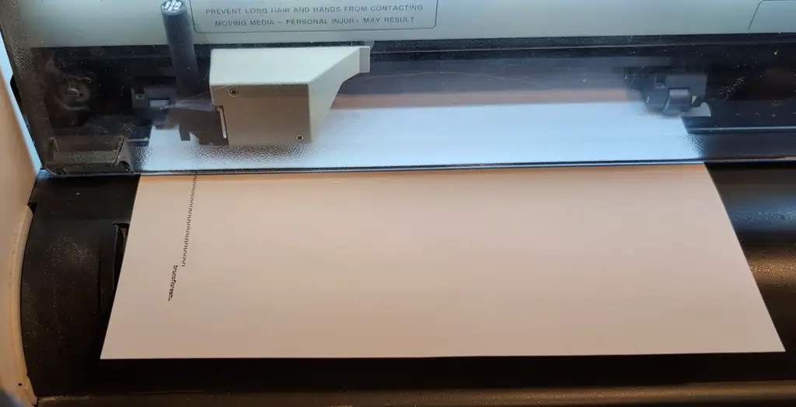</a>

An HP 7585B plotting Spider-Man. 1h plot.

[Full timelapse](docs/readme/examples/plotter/timelapse.mp4)

<!-- /sample:plotter -->

## Map Studio

Draw 2D and 3D maps from OpenStreetMap data.

<!-- sample:washington -->

<a href="docs/readme/examples/washington/sheet.jpg">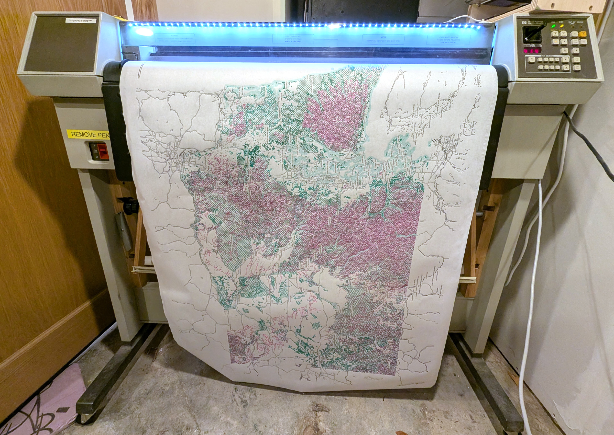</a>

Washington State, on 34 × 44-inch E-size paper. 8h plot.

[Map recipe](docs/readme/examples/washington/map-recipe.json)

<!-- /sample:washington -->

<!-- sample:paine-field -->

<a href="docs/readme/examples/paine-field/sheet.jpg">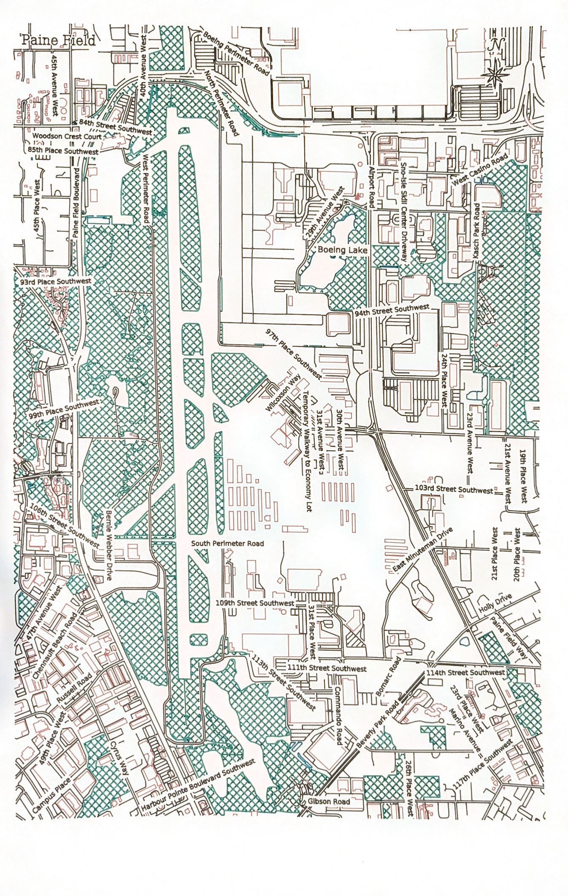</a>

Paine Field, on 11 × 17-inch paper. 40m plot.

[Map recipe](docs/readme/examples/paine-field/map-recipe.json)

<!-- /sample:paine-field -->

<!-- sample:seattle -->

<a href="docs/readme/examples/seattle/sheet.jpg">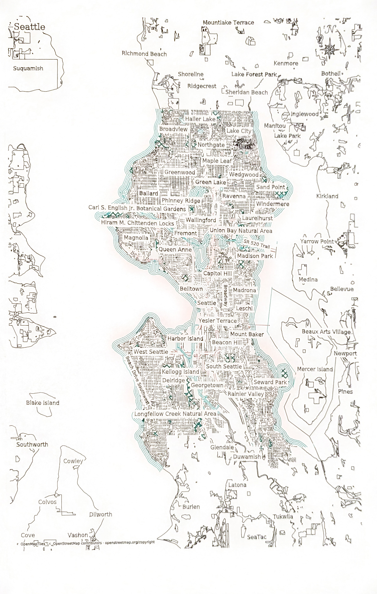</a>

Seattle, on 11 × 17-inch paper. 50m plot.

[Map recipe](docs/readme/examples/seattle/map-recipe.json)

<!-- /sample:seattle -->

<!-- sample:snoqualmie -->

<a href="docs/readme/examples/snoqualmie/sheet.jpg">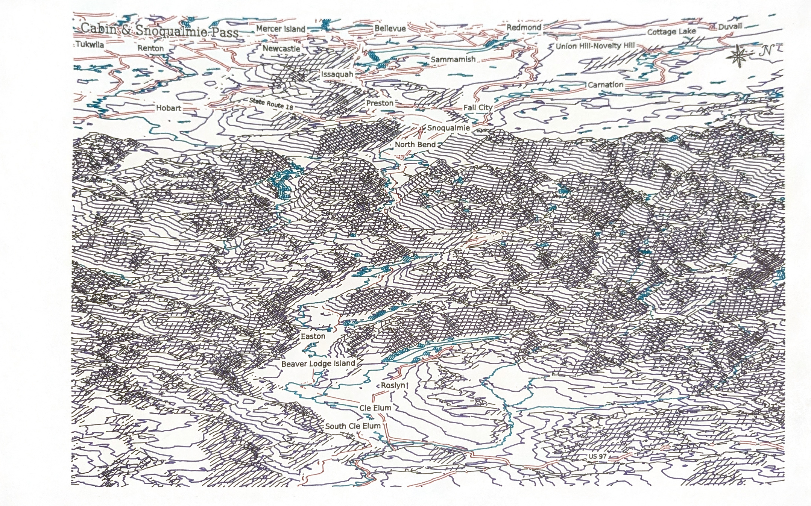</a>

Cabin & Snoqualmie Pass. Contours, hillshade hatching and waterways on 11 × 17-inch paper. 1h plot.

[Map recipe](docs/readme/examples/snoqualmie/map-recipe.json)

<!-- /sample:snoqualmie -->

<!-- sample:ravenna -->

<a href="docs/readme/examples/ravenna/sheet.jpg">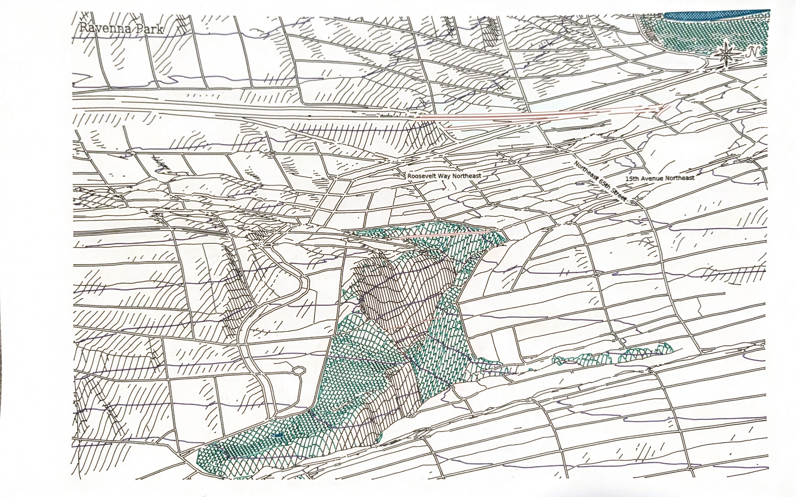</a>

Ravenna Park in relief, with forest hatching draped across the ravine. 35m plot.

[Map recipe](docs/readme/examples/ravenna/map-recipe.json)

<!-- /sample:ravenna -->

## PDF Studio

Render vector and raster graphics with pens. Print to Plotline over IPP from
applications such as Inkscape and FreeCAD, or open a PDF, SVG or image directly.
Choose how colors, fills and fine details become pen strokes, then inspect the
result before sending it to the plotter.

<!-- sample:freecad -->

<a href="docs/readme/examples/freecad/sheet.jpg">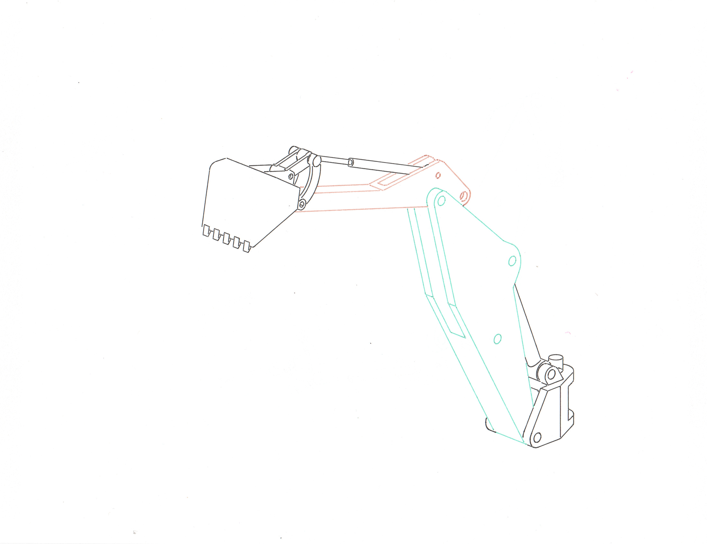</a>

A FreeCAD assembly, drawn with three pens on Letter paper. 1m plot.

[FreeCAD document](docs/readme/examples/freecad/drawing.FCStd) · [PDF](docs/readme/examples/freecad/versions/letter-proof/source.pdf)

<!-- /sample:freecad -->

<!-- sample:spider-man -->

<a href="docs/readme/examples/spider-man/sheet.jpg">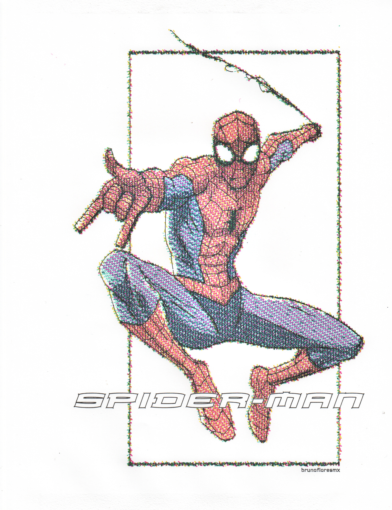</a>

The finished Letter-size plot: colored screening, black detail and outlined vector lettering. 1h plot.

In this illustration by [brunofloresmx](https://www.deviantart.com/brunofloresmx/art/Spiderman-1401741847),
the bitmap becomes colored pen screening with recovered black strokes for
clarity. The lettering added in Inkscape remains vector artwork. White letters
clear the earlier drawing; their black outlines are drawn with the pen.

[Editable SVG](docs/readme/examples/spider-man/source.svg) · [PDF](docs/readme/examples/spider-man/versions/plotted/source.pdf)

<!-- /sample:spider-man -->

## Pattern Studio

Forty-seven generative designs made for pen plotting: fractals, branching plants,
space-filling curves, spirographs, interlace, guilloché, reaction–diffusion contours
and more.

<!-- sample:hilbert -->

<a href="docs/readme/examples/hilbert/sheet.jpg">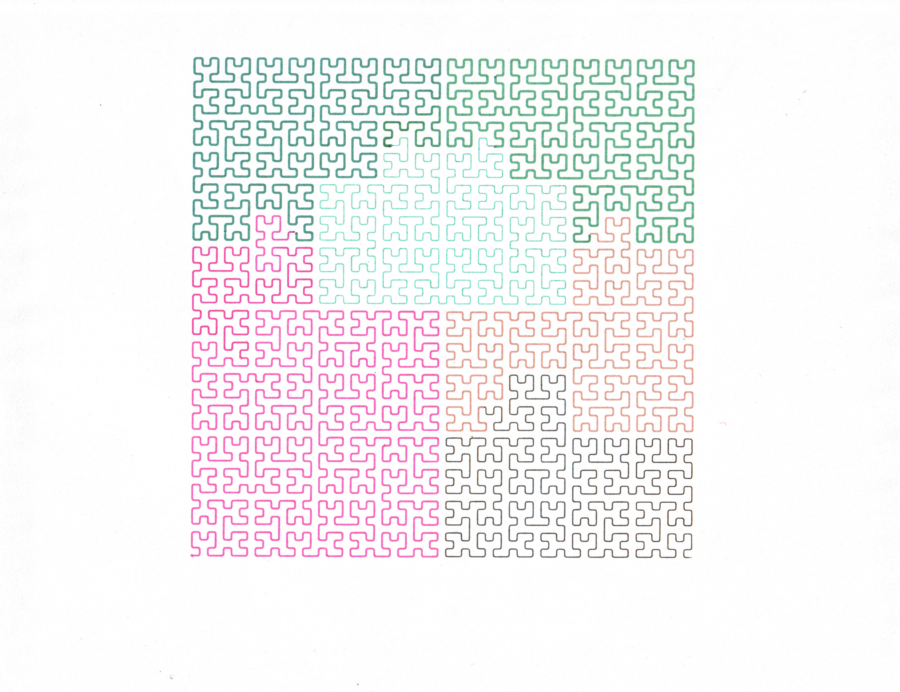</a>

A Hilbert curve cycling through the carousel colors, on Letter paper. 6m plot.

[Pattern recipe](docs/readme/examples/hilbert/pattern-recipe.json)

<!-- /sample:hilbert -->

<!-- sample:plant -->

<a href="docs/readme/examples/plant/sheet.jpg">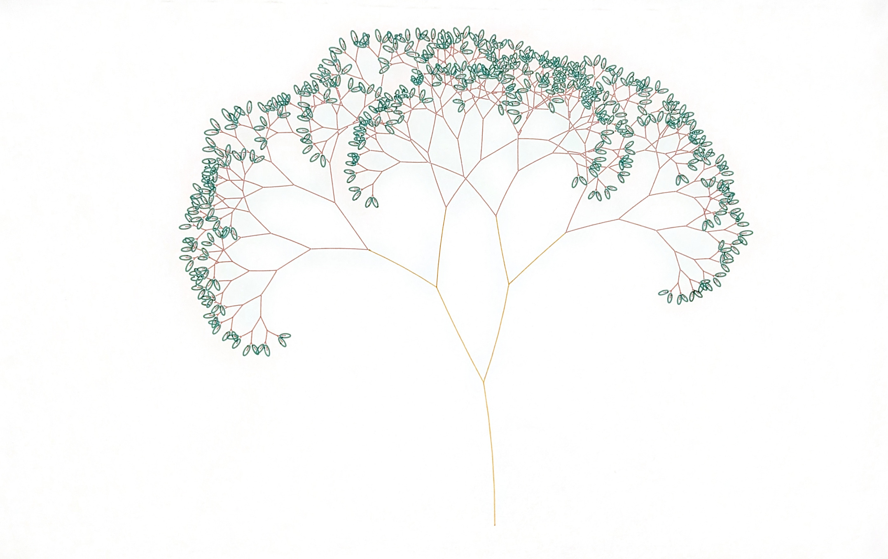</a>

Branches and green leaves, drawn on 11 × 17-inch paper. 7m plot.

[Pattern recipe](docs/readme/examples/plant/pattern-recipe.json)

<!-- /sample:plant -->

<!-- sample:sierpinski -->

<a href="docs/readme/examples/sierpinski/sheet.jpg">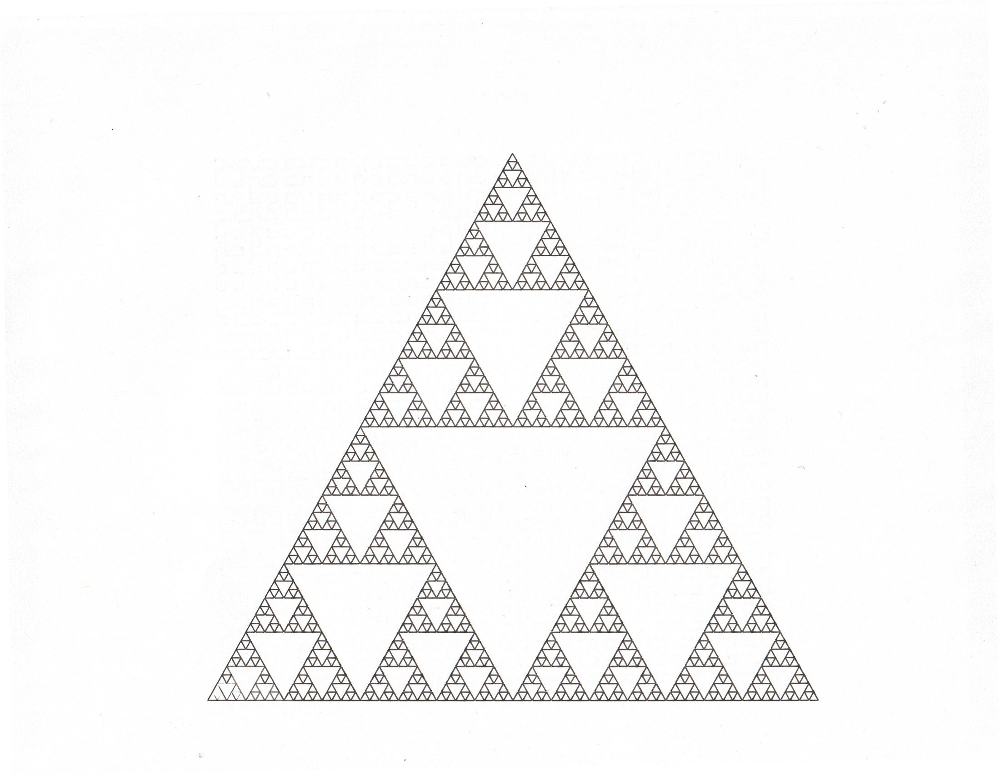</a>

Recursive triangles, drawn on Letter paper. 3m plot.

[Pattern recipe](docs/readme/examples/sierpinski/pattern-recipe.json)

<!-- /sample:sierpinski -->

<!-- sample:spirograph -->

<a href="docs/readme/examples/spirograph/sheet.jpg">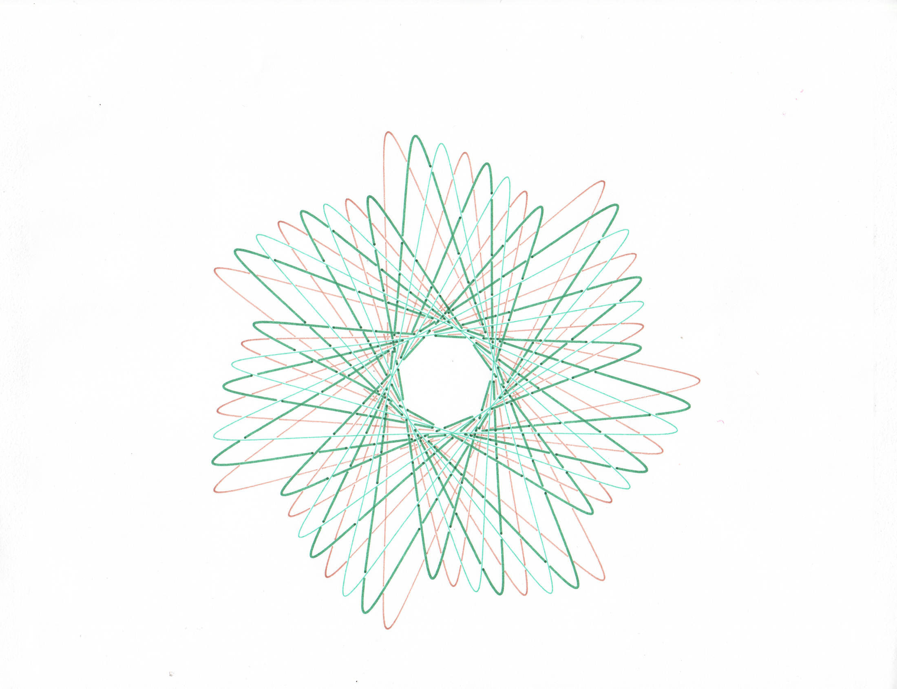</a>

A three-pen spirograph on Letter paper. 5m plot.

[Pattern recipe](docs/readme/examples/spirograph/pattern-recipe.json)

<!-- /sample:spirograph -->

## Maze Studio

Make mazes on square, hexagonal or triangular grids.

<!-- sample:hex-maze -->

<a href="docs/readme/examples/hex-maze/sheet.jpg">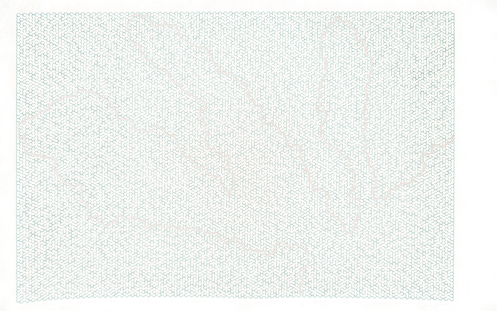</a>

A hexagonal maze and its solution, on 11 × 17-inch paper. 35m plot.

[Maze recipe](docs/readme/examples/hex-maze/maze-recipe.json)

<!-- /sample:hex-maze -->

[Explore Maze Studio.](docs/maze-studio.md)

## HPGL Studio

See the pen paths, match the drawing's inks to the pens in your carousel, check
the loaded paper, and plot.

<!-- sample:hpgl -->

<a href="docs/readme/examples/hpgl/studio.png">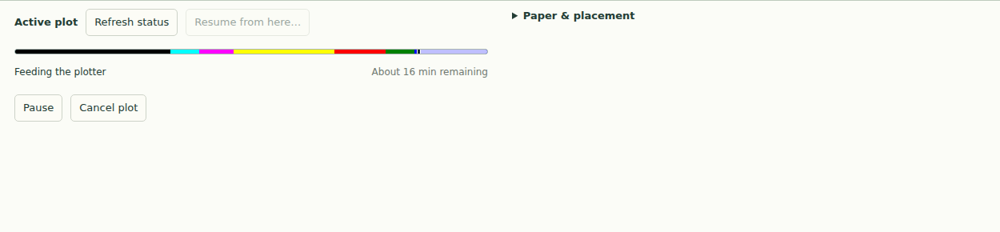</a>

A screenshot of the live HPGL Studio Plotter drawer.

<!-- /sample:hpgl -->

Print a calibration sheet and scan it back in to measure your actual pen widths
and sample their appearance on paper.

<!-- sample:calibration -->

<a href="docs/readme/examples/calibration/sheet.jpg">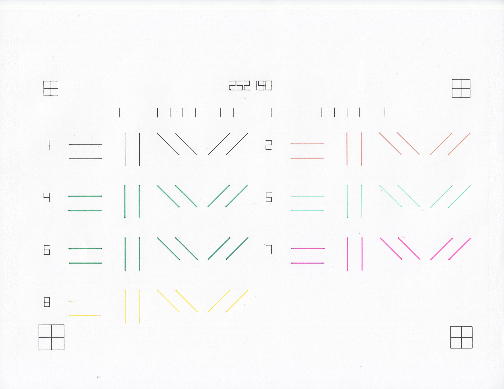</a>

A plotted calibration sheet scanned back in at 1200 dpi enables color and stroke width measurement. 1m plot.

<!-- /sample:calibration -->

<!-- sample:stroke -->

<a href="docs/readme/examples/stroke/stroke.png">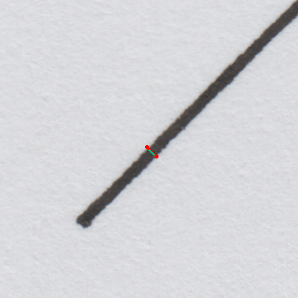</a>

A crop from that scan showing stroke width measurement.
This black pen measured 0.358 mm.

<!-- /sample:stroke -->

## Supported devices

Developed and tested with Jon's HP 7585B. The studios can prepare and preview
artwork without a connected plotter. Other devices will need their own paper,
transport and control support.

## Run it

Linux setup and the optional Raspberry Pi USB-to-serial bridge are documented in the
[setup guide](docs/GETTING_STARTED.md).

Windows is untested, good luck.

## License and credits

Plotline-authored code is [GNU AGPL v3](LICENSE). Jon's photos and example recipes
are [CC BY 4.0](docs/readme/ASSET-LICENSE.md). Third-party artwork, map data,
models and dependencies carry their own licenses. See the
[sample credits and source notes](docs/readme/CREDITS.md).
