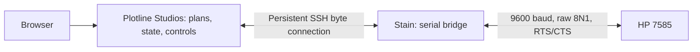

# Stain: a reproducible serial bridge

Plotline Studios on dev owns **every plotting decision**: geometry, paper queries,
pen choices, durable job state, progress, pause/resume/cancel and recovery.
Stain is an authenticated byte connection to the serial port. It has no HPGL
parser, jobs, plot identifiers, checksums, paper policy or replay mechanism.



Closing the browser leaves the service feeding. Losing the service-to-Pi link
stops feeding after buffered movement; the Pi never injects a timeout pen-up or
resumes a job. Plotline Studios records uncertain delivery and never automatically
replays bytes. Explicit UI pause/cancel are HPGL actions generated by Plotline Studios
at complete command boundaries. The plotter's front panel is the immediate stop.

The protocol-1 spooler, first boots, USB investigations, margin calibration and
validation-timeout diagnosis are preserved in [HISTORY.md](HISTORY.md). Those
old job RPC commands are historical. The original archaeological source remains
unchanged under `archealogy/`.

## Installed hardware and transport

Stain is an original Raspberry Pi **Model B Rev 2**, ARMv6, 700 MHz. Its USB
Wi-Fi adapter is an Edimax EW-7811Un (RTL8188CUS). The replacement PL2303 serial
adapter passed 100 repeated queries; the first adapter lost characters.

Stable serial path:
`/dev/serial/by-id/usb-Prolific_Technology_Inc._USB-Serial_Controller-if00-port0`.
The bridge sets 9600 baud, raw 8N1 and RTS/CTS explicitly. There is one serial
owner at a time. Nothing opens the serial port merely to inspect bridge status.

`device.py serve` runs under the `plotline-device` systemd unit as
`plotline`, with dialout access and a local Unix socket. The restricted service
SSH key forces `device.py client`, which carries the persistent connection
between SSH stdio and that socket. No shell, forwarding or public TCP listener
is granted. The normal web service uses Rust plus OpenSSH; Python runs on the Pi.

Transport protocol 2 is newline-framed JSON with `status`, `open`, `write`,
`read`, `close`, and optional `timing`. Byte arrays carry arbitrary values, including fragments of
commands. This is transport framing, not HPGL sentences. Writes are at most
512 bytes; acknowledgement means those bytes were passed to serial and the
Linux transmit queue has fallen to at most 64 bytes. Adapter and plotter buffers
remain beyond that acknowledgement. Reads return bytes without interpreting
replies. A disconnected session drops pending bridge/Linux output, releases
the port, and sends no extra bytes. Later connections start empty.

The optional `tx_queue_timing_v1` capability timestamps observed host transmit
queue boundaries. `timing` enables bounded telemetry frames on the same connection;
Plotline Studios stores them with the exact prepared HPGL on dev. There is no Pi log
or model, and queue retirement does not prove delivery to the plotter or motion
completion. See [capture format and fitting plan](../docs/plot-timing.md).
The image builder includes this source automatically; no separate card tweak is needed.

Plotline Studios's Plot button uses one connection to query `OI` and `OH` once, check
that the selected layout fits the actual loaded window, and feed the drawing. All parsing and decisions
happen on dev. During plotting, UI status reads the service's local state, so
browser polling does not spawn SSH sessions or compete for serial I/O.

## Connection configuration on dev

Keep credentials under ignored `controller/state/private/`. A connection JSON
uses absolute paths:

```json
{
  "destination": "plotline@stain.jonh.net",
  "identity_file": "/root/plotline/controller/state/private/stain-service-ed25519",
  "known_hosts_file": "/root/plotline/controller/state/private/stain-known-hosts",
  "plotting_enabled": true
}
```

`plotting_enabled` is a **Plotline Studios policy**, default false if absent. Stain's
configuration contains only the serial device path. Physical pen inventory is
edited in Plotline Studios's eight-slot carousel and saved separately as
`<state>/carousel.json` on the service. Old connection-file `carousel` labels and
availability are migrated once; later changes use the UI. No carousel settings
are stored on stain. Do not infer unknown slots or physical widths.

```sh
python3 controller/scripts/dev-server.py restart \
  --device-config controller/state/private/stain-connection.json
python3 controller/appliance/rpc.py \
  --config controller/state/private/stain-connection.json status
```

The second command is a read-only bridge diagnostic. It no longer offers upload,
start or plot controls. Use Plotline Studios for those. `--device-helper` on the Rust
binary is an optional transport-process override for tests, not a normal runtime
dependency.

## Updating an existing card

No card rewrite is needed. Existing cards keep their legacy service account, SSH forced command and paths; the updater detects them. Fresh cards use the `plotline` account and `plotline-device` service. Keep an existing connection JSON unchanged, including its SSH destination. Update only when the pen is parked and the service
has no active feed. Stop Plotline Studios during installation so a new connection
cannot race with the serial-port change:

```sh
python3 controller/scripts/dev-server.py stop
python3 controller/appliance/install_agent.py \
  --host pi@stain.jonh.net \
  --known-hosts controller/state/private/stain-known-hosts \
  --dev-state controller/state/jobs --inspect
# Repeat without --inspect to install, then:
python3 controller/scripts/dev-server.py restart
```

For the one-time transition from the old spooler, a submitted/cancelled execution
requires `--completed-attempt UUID` **after the operator has observed completion**.
The installer copies that execution into the matching dev ticket, retaining its
byte/command counts and UUID. Active or uncertain executions refuse migration.
Jon confirmed the Ravenna attempt `a626cc9b-0544-47ce-8457-d66a8ea62011` had
finished and the plotter was off; this is the migration's completion evidence.
The 90,450-command, 1,165,977-byte attempt remains recorded on dev.

The installer backs up source, configuration and unit under
`/var/lib/plotline/upgrades/` (the legacy `/var/lib/squidprint/upgrades/` on existing cards), verifies protocol 2 readiness, and rolls back
those files if readiness fails. It strips legacy plotting settings from the
Pi config. Old `/var/lib/squidprint/jobs/` files and receipts remain untouched;
the bridge never reads them. The migration report is also retained on dev in
`controller/state/jobs/plots/legacy-device-status.json`. Subsequent bridge
updates refuse while a byte connection owns the port.

Live cutover on 2026-10-30 installed bridge SHA-256
`249fdad2e53e3cdd485fcfeedf16e405c5295029c77da7b031752068301b2506`.
The previous installation is under
`/var/lib/squidprint/upgrades/20261030T163022Z-a05d6a7b-64f3-4791-adf4-451a648e49c0/`.
After Jon powered/readied the plotter and loaded paper, the live browser review
received `7585B` and matching limits `[-7548,-5088,7548,5088]`, or
377.4 × 254.4 mm. Ravenna's 90,450-command review passed, the bridge released
the port, and the completed execution stayed unchanged. No drawing was started.
The earlier query got no reply while the plotter was not ready; power/Remote
readiness and paper changed together, so this does not isolate a paper-only
query restriction. Evidence is in
`controller/state/diagnostics/2026-10-30/serial-bridge-review.json`.

## Build a fresh card

Use Linux, Python 3.10+, OpenSSH client and mtools:

```sh
sudo apt-get install mtools openssh-client
mkdir -p controller/state/private
chmod 700 controller/state/private
cp controller/appliance/example.json controller/state/private/stain.json
```

Fill operator/service **public** keys and network configuration in that private
JSON. The example uses Ethernet DHCP. For Wi-Fi, supply Netplan `wifis.wlan0`
with `dhcp4: true`, `optional: true`, `regulatory-domain` and `access-points`.
Dev's existing private stain config already contains the working network details.
`device` needs only the stable `/dev/serial/by-id/...` path; obsolete `limits`
and `plotting_enabled` from older image configs are discarded by the builder.

```sh
python3 controller/appliance/build_image.py \
  --config controller/state/private/stain.json \
  --output build/controller-image/stain-ready.img
```

The builder pins the official **2026-10-06 Raspberry Pi OS Lite 32-bit Trixie**
image and verifies compressed/extracted hashes. It embeds current bridge source,
unit and boot finalizer through cloud-init on the FAT partition, without mounts,
chroot or first-boot package downloads. 32-bit is necessary for this ARMv6 board.
The manifest records base image, source commit/dirty flag, payload hashes and
image hash; FAT metadata means whole-image builds are not claimed byte-identical.
Build release images from committed source.

Optional `host_key_files.ed25519_private` and `.ed25519_public` provide a dedicated
host-key pair. The builder verifies their match. Keep image/config/key files
private: the image contains Wi-Fi credentials and possibly the host private key.
Images and OS cache live under ignored `build/controller-image/`; credentials
and unique state are under `controller/state/`, included in the existing Plotline
backup selection. Inclusion does not establish that a backup has run.

Flash from Linux using the whole card device, after identifying it:

```sh
sudo python3 controller/appliance/flash_image.py \
  build/controller-image/stain-ready.img --device /dev/sdX --confirm-device /dev/sdX
```

This erases the selected card. The script checks device type, capacity and mounts.
Use `/dev/sdb`, for example, not partition `/dev/sdb1`. An 8 GB card is sufficient;
stain currently uses one. See [historical card delivery notes](HISTORY.md) for
the bingen bundle workflow and the original writer correction.

The first boot expands/provisions the card and previously took about 10 minutes.
`finalize_boot.py` preserves rendered Wi-Fi connections as native NetworkManager
profiles, removes generated Netplan and disables later cloud-init runs. Ordinary
Wi-Fi-only restarts then reached SSH in about 2½ minutes on the original Pi.
These optimizations remain in the image build. Root-only rollback records live
under `/var/lib/plotline-provision/`; `finalize_boot.py rollback` restores them,
refusing to overwrite later edits. Use NetworkManager for later network changes.

## Recovery and validation

All new attempt records live in dev's `controller/state/jobs/plots/`. An accepted
byte write is not physical completion. **Pen parked · mark finished** records the
operator's observation on dev. Connection loss after a write may leave the last
packet partly delivered; **I reset the plotter** clears the local block only
after the operator has reset the hardware. Neither action sends a hardware reset.
On a service restart, active/paused attempts become interrupted and never replay;
a submitted attempt remains awaiting physical completion. The old Pi spool is
only historical evidence and is never a recovery source for the bridge.

```sh
python3 -m unittest discover -s controller/appliance -v
cargo test --locked --manifest-path controller/Cargo.toml
cargo clippy --locked --manifest-path controller/Cargo.toml --all-targets -- -D warnings
cargo build --locked --release --manifest-path controller/Cargo.toml
npm test --prefix controller
```

Transport tests use real pseudoterminals: arbitrary/fractured bytes, short writes,
exclusive ownership, disconnect under backpressure, no injected bytes or replay,
and the forced-command stdio client. Rust tests cover frozen plans, paper checks,
explicit pause/resume/cancel, uncertain writes and restart recovery. The browser
suite uses a local fake byte transport and kills/restarts the server mid-stream.
No test fixture can access the physical plotter.

`boot_smoke.py` remains available for an optional disposable ARMv6 QEMU boot:

```sh
python3 controller/appliance/boot_smoke.py build/controller-image/stain-ready.img \
  --output build/controller-image/boot-check --qemu8-workaround \
  --service-identity controller/state/private/stain-service-ed25519
```

It checks protocol 2 and restricted SSH, with emulator-only DTB/network changes.
The current bridge seed and real-board upgrade are checked separately; an old
image is not evidence that a newly changed seed has booted in QEMU. Production
integration and publication remain separate future work.
